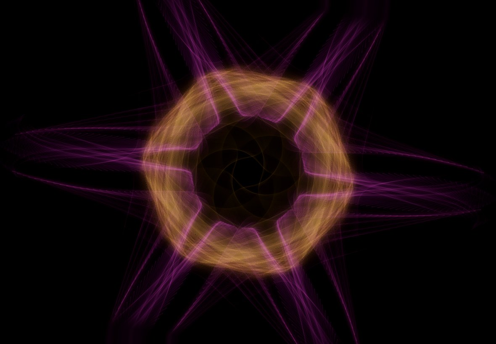
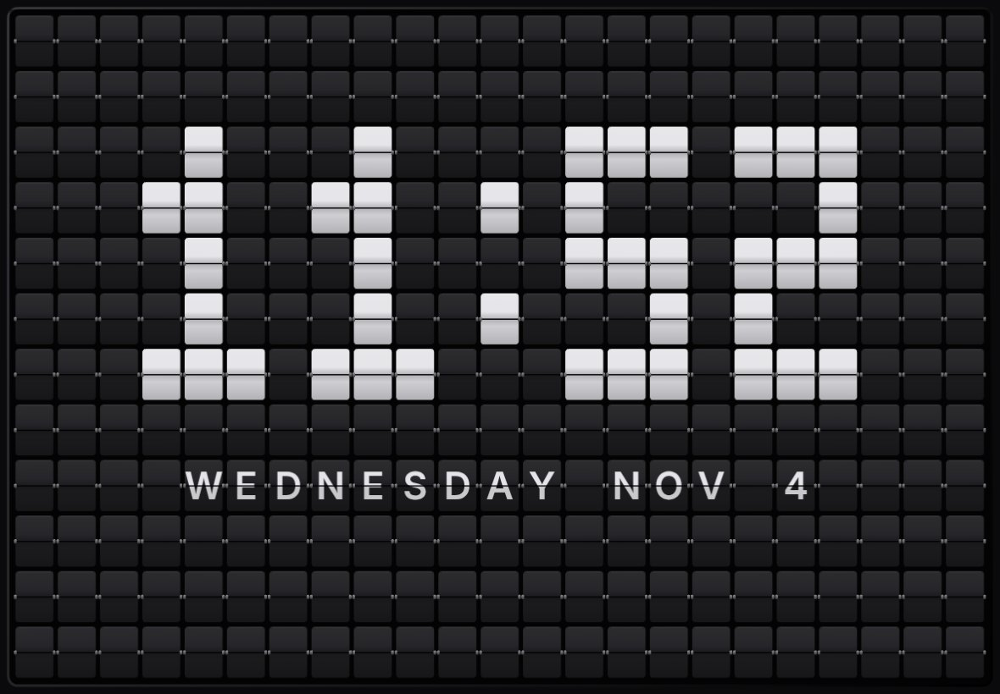
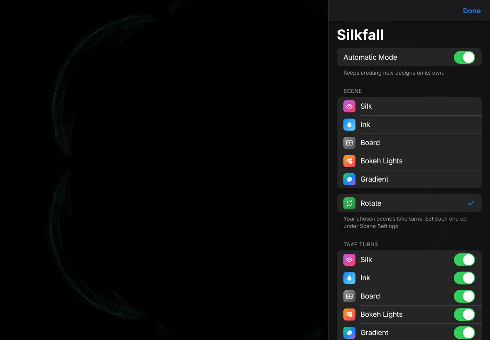

# Silkfall

Generative art for an iPad desk display. Five scenes that run on their own:

- **Silk**: glowing, symmetric threads.
- **Ink**: colour dropped into water, blooming and swirling.
- **Board**: a full-screen split-flap wall with a big flap clock, messages or a world-clock departures board.
- **Bokeh Lights**: soft city lights through a rainy window.
- **Gradient**: soft blobs of colour slowly morphing, with ten darker colour sets of its own.

Pick one, or let them take turns with **Rotate**. Palettes, a customizable clock, breathing, tilt parallax and a night mode work across all of them.



| Ink | Board |
| --- | --- |
|  |  |
| **Bokeh Lights** | **Gradient** |
|  |  |

Settings live in an iPadOS-style sheet: tap the screen to open it.



## Two versions in one repository

- **Web app**: the files at the top level (`index.html` and friends). If GitHub Pages is turned on, it's served at `https://atharva309.github.io/SILKFALL/`.
- **iPad app**: the `ios` folder. GitHub builds it in the cloud every time you upload changes and publishes **Silkfall.ipa** on this repository's **latest** release. You install it with AltStore (or SideStore).

## Download link for the iPad app

```
https://github.com/Atharva309/SILKFALL/releases/latest/download/Silkfall.ipa
```

## Updating

Change `index.html` (or anything else), upload it, and wait about five minutes. The **Actions** tab shows the build. When it's green, the new `Silkfall.ipa` is on the latest release and the web app is updated too.

## What the iPad app adds over the web app

- Opens straight into full screen, with no browser bars, status bar or home indicator.
- Keeps the screen awake by itself while it's open, following the **Keep screen awake** switch in settings.
- Tilt parallax works without a permission prompt.
- Shortcuts can open it with **Open App**, so it can start automatically when you put the iPad on the charger.
